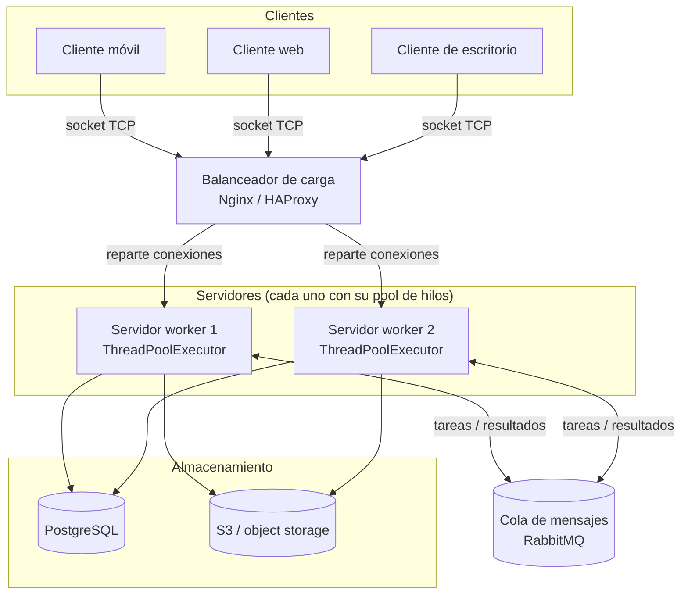

# Diagrama: sistema distribuido (PFO3)

> ⚠️ Diagrama y código de práctica, no una entrega.

## Qué implementa el código de este repo (y qué no)

Esto es una práctica de sockets, no una infraestructura real. Lo que se
puede demostrar con código simple en una sola máquina:

- ✅ **Un servidor que recibe tareas por socket y las reparte a un
  `ThreadPoolExecutor`** (el "pool de hilos" de cada worker del diagrama).
  Cada conexión de cliente se atiende en un hilo del pool, así que varios
  clientes se procesan en paralelo sin bloquearse entre sí.
- ✅ **Un cliente que envía tareas y recibe resultados.**
- ❌ **Nginx/HAProxy, RabbitMQ, Postgres y S3 reales**: no tiene sentido
  levantar esa infraestructura para una práctica de una tarde. El
  diagrama de arriba muestra dónde irían si esto fuera a producción; el
  código demuestra el patrón cliente-servidor-workers que es la parte que
  pide la consigna de sockets.
